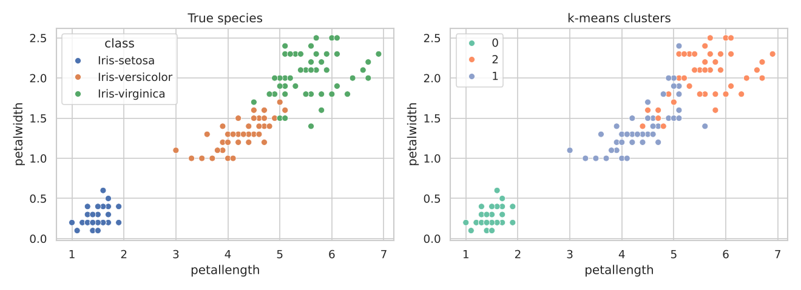

# Data Mining Techniques: WEKA Project Reproduced in Python

Five datasets and four kinds of data mining task. I first ran this project in WEKA Explorer, then rebuilt every experiment in Python on the same ARFF files. For algorithms scikit-learn does not include (OneR, Winnow, PRISM) I wrote my own implementations.



## Datasets and tasks

| Dataset | Task | Methods |
|---|---|---|
| Iris (150) | Classification, clustering | Naive Bayes, IB1 (1-NN), OneR; k-means, hierarchical (Ward) |
| Breast Cancer (286) | Binary classification | Logistic regression, Winnow |
| CPU (209) | Regression | Simple vs multiple linear regression |
| Supermarket (4,627 baskets) | Association rules | Apriori |
| Weather (14) | Tree and rule learning | Entropy decision tree (ID3-style), PRISM |

## Results (Python, 10-fold cross-validation)

| Dataset | Result | Original WEKA result |
|---|---|---|
| Iris | Naive Bayes 96.0%, IB1 96.0%, OneR 94.7% (petal length); k-means ARI 0.62 | Naive Bayes and IB1 about 96% |
| Breast Cancer | Logistic regression 73.1%, Winnow 70.0%, majority class 70.3% | Logistic regression 68.9%, beat Winnow |
| CPU | Correlation 0.91 (multiple) vs 0.85 (best single attribute, MMAX) | Multiple regression correlation 0.90 |
| Supermarket | 31 rules at ≥90% confidence; best: biscuits + staples → bread and cake, 91% confidence, lift 1.27 | Biscuits → bread and cake, 92% confidence, lift 1.27 |
| Weather | Tree and PRISM find the same patterns (outlook, then humidity or wind) | ID3 vs PRISM |

**What the comparison shows**

- Setosa separates perfectly; versicolor and virginica overlap, which limits both classifiers and clusterers.
- Breast Cancer recurrence is hard to predict from these attributes. Logistic regression beats the majority-class baseline by only 3 points, and Winnow does not beat it.
- No single hardware spec explains CPU performance as well as all of them together.
- Every strong supermarket rule predicts bread and cake, the most common department, and lift shows the rules still carry information.

## Files

| File | Contents |
|---|---|
| `data_mining_techniques.ipynb` | All five experiments in Python |
| `data/*.arff` | The WEKA datasets |
| `Data_Mining_Project__Presentation.pptx` | Original WEKA presentation |

## How to run

```bash
git clone https://github.com/mehtesham13/data-mining-techniques.git
cd data-mining-techniques
pip install -r requirements.txt
jupyter notebook data_mining_techniques.ipynb
```

Author: Muhammad Ehtesham · [LinkedIn](https://www.linkedin.com/in/muhammad-ehtesham-dsa)
